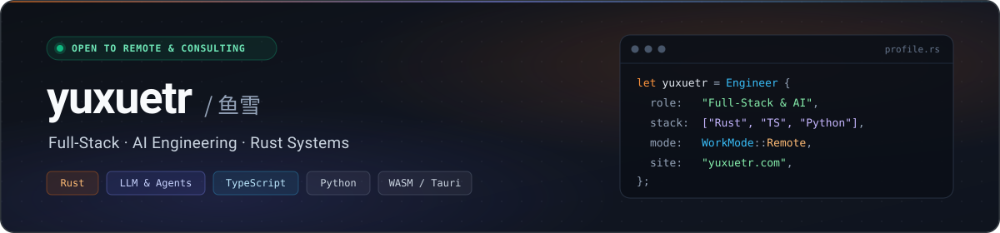

  <a href="https://yuxuetr.com">
    <picture>
      <source media="(prefers-color-scheme: dark)" srcset="./assets/banner-dark.svg" />
      <source media="(prefers-color-scheme: light)" srcset="./assets/banner-light.svg" />
      
    </picture>
  </a>

 

  
  
  
  
  
  

 

### About · 关于我

Hi, I'm **yuxuetr (鱼雪)** — an independent **Full-Stack, AI & Rust Remote Developer** with 10+ years of engineering experience spanning C++/Linux backend services, Python deep learning (CV, NLP & 3D medical imaging), and modern Rust & TypeScript product engineering.

- **Rust & Systems**: Building high-reliability backends with `Axum`, cross-platform desktop apps with `Tauri`, WebAssembly modules, and full-stack interfaces with `Dioxus`.
- **Agent Systems & AI Apps**: Architecting production-grade AI Agent systems (ReAct, typed subagents, DAG workflows, `MCP` tool ecosystems), structured JSON Schema outputs, and RAG pipelines.
- **LLM Deployment, Fine-Tuning & Eval**: Hands-on across LLM inference & deployment, domain fine-tuning (SFT / LoRA), automated LLM evaluation & benchmarking systems, and Rust ML/data stacks (`Candle`, `Burn`, `LanceDB`, `Apache Arrow`).
- **Remote & Consulting**: Available for remote engineering roles, AI/Rust technical consulting, and end-to-end product delivery — 欢迎通过邮件或微信联系大模型落地、Agent 系统开发与技术咨询合作。

---

### Featured Projects · 精选项目

| Project | Description | Stack |
| :--- | :--- | :--- |
| [**dioxuspress**](https://github.com/dioxuspress/dioxuspress)&nbsp;·&nbsp;[Site](https://dioxuspress.dev) | Pure-Rust fullstack docs, blog & community engine on Dioxus 0.7, Axum & Tantivy | `Rust` `Dioxus` `Axum` |
| [**dioxus-ui**](https://github.com/dioxuspress/dioxus-ui)&nbsp;·&nbsp;[Site](https://ui.dioxuspress.dev) | 84 shadcn/ui-style components for Dioxus 0.7 with headless primitives & `dxui` CLI | `Rust` `Dioxus` `Tailwind` |
| [**DataOmni**](https://github.com/dataomni-rs/DataOmni)&nbsp;·&nbsp;[Site](https://dataomni.dev) | Native Rust + Tauri 2 desktop client for SQL, MongoDB, Redis, Neo4j & Elasticsearch with write guardrails & read-only MCP | `Rust` `Tauri 2` `MCP` |
| [**yanshi**](https://github.com/yeying-ai/yanshi)&nbsp;·&nbsp;[Site](https://yanshi.dev) | Multimodal content-production runtime in Rust: turn ideas, repos & PDFs into PPTX slides, narrated 1080p videos & Typst PDFs via DAGs, ReAct agents & MCP | `Rust` `AI Agents` `MCP` |
| [**phonon**](https://github.com/yeying-ai/phonon) | Comprehensive Rust audio processing & AI podcast engine — DSP, EBU R128 LUFS, TTS/STT, Axum API, MCP server, WASM & Dioxus Studio | `Rust` `Audio DSP` `AI` |
| [**seekcli**](https://github.com/yeying-ds/seekcli)&nbsp;·&nbsp;[Site](https://yeying-ds.github.io/seekcli/) | Local Rust coding agent for the terminal — ReAct loop, typed subagents, curated skills, clipboard vision, safety policy gate & MCP | `Rust` `CLI` `Agent` |
| [**axum-template**](https://github.com/yuxuetr/axum-template) | Generalized, production-oriented web application template for Rust Axum (`32+ ★`) | `Rust` `Axum` `Tokio` |
| [**rust-template**](https://github.com/yuxuetr/rust-template) | Ready-to-use `cargo-generate` Rust project starter template with tooling & project conventions | `Rust` `Template` `CLI` |

---

### Tech Stack · 技术栈

| Domain | Technologies |
| :--- | :--- |
| **Systems & Backend** |        |
| **AI / LLM & Data** |     |
| **Frontend & Cross-Platform** |       |
| **Infra & Tools** |      |

---

### Latest from Blog · 最新文章

<!-- BLOG-POST-LIST:START -->- [关于我](https://yuxuetr.com/blog/about) · `2026-09-08`
- [拒绝“玩具化”：用 Rust + JSON Schema 构建工业级 LLM 智能体](https://yuxuetr.com/blog/2026/01/18/rust-llm-structured-output) · `2026-01-18`
- [Python 的 Rust 化时刻：用 Pydantic 重构你的编程思维](https://yuxuetr.com/blog/2026/01/10/python-struct) · `2026-01-10`
- [编程范式的辩证回归：在 C 与 OOP 之间寻找“刚刚好”--Rust](https://yuxuetr.com/blog/2026/01/10/the-better-programming) · `2026-01-10`
- [Wasmi 1.0：轻量 WebAssembly 解释器终于稳定](https://yuxuetr.com/blog/2025/12/06/wasmi-1-0) · `2025-12-06`
<!-- BLOG-POST-LIST:END -->

Auto-synced daily from <a href="https://yuxuetr.com/blog">yuxuetr.com/blog</a> via GitHub Actions.

---

### GitHub Analytics · 数据概览

  <picture>
    <source media="(prefers-color-scheme: dark)" srcset="https://github-readme-stats.vercel.app/api?username=yuxuetr&show_icons=true&hide_border=true&bg_color=00000000&title_color=F97316&icon_color=818CF8&text_color=CBD5E1" />
    <source media="(prefers-color-scheme: light)" srcset="https://github-readme-stats.vercel.app/api?username=yuxuetr&show_icons=true&hide_border=true&bg_color=00000000&title_color=EA580C&icon_color=4F46E5&text_color=334155" />
    
  </picture>
  <picture>
    <source media="(prefers-color-scheme: dark)" srcset="https://github-readme-stats.vercel.app/api/top-langs/?username=yuxuetr&layout=compact&langs_count=8&hide_border=true&bg_color=00000000&title_color=F97316&text_color=CBD5E1" />
    <source media="(prefers-color-scheme: light)" srcset="https://github-readme-stats.vercel.app/api/top-langs/?username=yuxuetr&layout=compact&langs_count=8&hide_border=true&bg_color=00000000&title_color=EA580C&text_color=334155" />
    
  </picture>

  <picture>
    <source media="(prefers-color-scheme: dark)" srcset="https://streak-stats.demolab.com/?user=yuxuetr&hide_border=true&background=00000000&ring=F97316&fire=F97316&currStreakLabel=F8FAFC&sideLabels=94A3B8&currStreakNum=F8FAFC&sideNums=E2E8F0&dates=64748B&stroke=1E293B" />
    <source media="(prefers-color-scheme: light)" srcset="https://streak-stats.demolab.com/?user=yuxuetr&hide_border=true&background=00000000&ring=EA580C&fire=EA580C&currStreakLabel=0F172A&sideLabels=64748B&currStreakNum=0F172A&sideNums=334155&dates=64748B&stroke=E2E8F0" />
    
  </picture>

---

  <picture>
    <source media="(prefers-color-scheme: dark)" srcset="https://raw.githubusercontent.com/yuxuetr/yuxuetr/output/github-contribution-grid-snake-dark.svg" />
    <source media="(prefers-color-scheme: light)" srcset="https://raw.githubusercontent.com/yuxuetr/yuxuetr/output/github-contribution-grid-snake.svg" />
    
  </picture>

 

  Lifelong Builder · Systems → Product · <a href="https://yuxuetr.com">yuxuetr.com</a>

